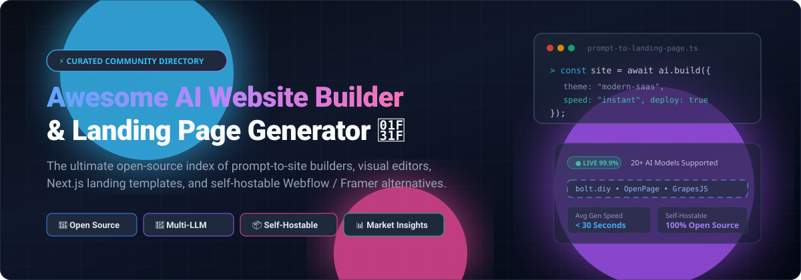

# 🌟 Awesome AI Website Builder & Landing Page Generator 🚀

> **The definitive curated list of the best AI-powered website builders 🛠️, automated landing page generators 📄, and prompt-to-web frameworks 🤖 — spotlighting open-source alternatives and leading SaaS solutions.**

---

AI website builders and landing page generators enable creators, developers, and businesses to transform natural language prompts, wireframes, and design specs into responsive, high-converting websites in seconds ⚡. While hosted SaaS platforms deliver managed infrastructure, an expanding open-source ecosystem offers self-hostable codebases, zero vendor lock-in 🔓, and programmatic customization via LLMs and AI coding agents 🦾.

---

## 📑 Table of Contents

- [📊 Sector Overview & Market Dynamics](#-sector-overview--market-dynamics)
- [☁️ SaaS / Hosted Platforms](#️-saas--hosted-platforms)
- [💻 Open-Source GitHub Projects](#-open-source-github-projects)
  - [🏗️ Full AI Website & App Builders](#️-full-ai-website--app-builders)
  - [⚡ AI Landing Page Generators](#-ai-landing-page-generators)
  - [🧩 Developer Templates & Foundational Frameworks](#-developer-templates--foundational-frameworks)
- [🔍 Feature Comparison Matrix](#-feature-comparison-matrix)
- [💖 Support & Sponsorship](#-support--sponsorship)
- [📈 Star History](#-star-history)
- [🤝 How to Contribute](#-how-to-contribute)
- [⚖️ Disclaimer](#️-disclaimer)

---

## 📊 Sector Overview & Market Dynamics

The global website builder market is estimated at **$4.0B–$4.7B**, with the dedicated AI website builder segment surging from **$3.1B towards $3.75B+** at a compound annual growth rate (**CAGR of ~20–25%**) 📈. 

The sector displays a **bifurcated, moderately fragmented market structure** 🌐: legacy giants (Wix, Shopify, GoDaddy, Squarespace) anchor market share and capital, yet the category remains intensely disrupted by an agile wave of AI-native challengers (such as Framer, Durable, 10Web, and Bolt.new) and self-hosted open-source builders that prevent a winner-take-all monopoly 🛡️.

---

## ☁️ SaaS / Hosted Platforms

Below is a breakdown of commercial AI website builders and landing page platforms, sorted in descending order by estimated company valuation / annual revenue 💰:

| Platform | Starting Price (Paid Tier) | Free Tier Limits / Evaluation | Company Size (Valuation / Revenue) | Key Features & Best Use Case |
| :--- | :--- | :--- | :--- | :--- |
| **[Wix Studio AI](https://www.wix.com/studio)** | $17/mo (Light tier, billed annually) | Free forever plan: 500 MB storage, 500 MB bandwidth, Wix ads, `wixsite.com` subdomain | **~$8B–$10B Valuation** ($1.5B+ ARR) | Enterprise-grade CMS, generative layout creation, ADI automation, and complete eCommerce infrastructure 🏬. |
| **[Hostinger AI Builder](https://www.hostinger.com/)** | $2.49–$2.99/mo (48-mo term; renews at $10.99/mo) | No free tier; offers 30-day money-back guarantee with full builder access | **~$500M+ Valuation** ($150M+ ARR) | Budget-friendly AI site builder coupled with managed cloud hosting, free custom domain, and business email ✉️. |
| **[Framer AI](https://www.framer.com/)** | $10/mo (Basic tier per site, billed annually) | Free forever plan: 1 project, banner branding, `framer.website` subdomain, free canvas design tools | **$2B Valuation** ($50M+ ARR) | Designer-centric visual canvas, high-fidelity responsive design, micro-interactions, CMS, and AI text/style tools 🎨. |
| **[B12](https://www.b12.io/)** | $24/mo (Website tier, billed annually) | Free plan: basic site generation draft, B12 subdomain, capped monthly AI tokens; optional 7-day $1 trial | **~$63M Valuation** (~$8.3M ARR) | Designed for professional services (consultants, legal, accounting) with built-in client invoicing, scheduling, and contracts 💼. |
| **[10Web](https://10web.io/)** | $10/mo (AI Starter, billed annually) | 3-day full-feature free trial with private site preview lock (no permanent free tier; requires upgrade to publish) | **~$30M–$40M Valuation** (~$25M ARR) | Automated WordPress site generator, Elementor visual widget replication, and Google Cloud managed hosting 🌐. |
| **[TeleportHQ](https://teleporthq.io/)** | $18/mo (per workspace seat, billed annually) | Free forever plan: 1 project workspace, `teleporthq.io` subdomain, free UI builder & basic code export | **~$15M–$20M Valuation** (~$3.67M Total Funding) | Visual front-end builder with OpenAI integration, real-time code generation (React, Vue, HTML/CSS), and Figma import 💻. |
| **[Durable](https://durable.co/)** | $22/mo (Launch tier, billed annually) | Free plan: unlimited site re-generations, 300 AI credits, up to 10 CRM contacts, hosted on `.durable.site` | **~$15M–$25M Valuation** (~$3M–$5M ARR) | 60-second end-to-end small business creation featuring integrated mini-CRM, AI copywriter, invoicing, and local SEO tools ⏱️. |
| **[Relume](https://www.relume.io/)** | $12/mo (Publish tier, billed annually) | Free plan: 1 AI project, 1,500 monthly page views on `relumesite.ai` subdomain, sitemap and wireframe generator | **Bootstrap / Venture-backed** (~$3.3M ARR) | AI sitemap generator, wireframe builder, and seamless Figma-to-Webflow component library export 📐. |
| **[CodeDesign.ai](https://codedesign.ai/)** | $24/mo (Growth tier, billed annually) | Free plan: 3 AI site generations, unlimited manual canvas editing, published on `codedesign.app` subdomain | **Early Stage / Bootstrapped** (~$1M–$2M ARR) | Prompt-to-web generator with visual canvas, responsive layouts, and direct clean HTML/React code export options 🪄. |
| **[Dorik AI](https://dorik.com/)** | $20.75/mo (Personal tier, billed annually) | 7-day free trial on paid plans (full access to test builder and templates; permanent free tier discontinued) | **Early Stage / Bootstrapped** (~$1M–$2M ARR) | Intuitive no-code website builder with AI copy, image generation, custom forms, white-label CMS, and responsive layouts 📱. |

---

## 💻 Open-Source GitHub Projects

Explore battle-tested open-source website builders, landing page engines, and AI scaffolding templates you can self-host, audit, and extend without licensing lock-in 🔓.

The repositories below are **sorted in descending order by GitHub_Stars** ⭐:

### 🏗️ Full AI Website & App Builders

* **[GrapesJS](https://github.com/GrapesJS/grapesjs)**   
  *Next-generation open-source multi-purpose Web Builder framework.* Foundational visual editor framework used across hundreds of web builder projects. Extensible architecture supporting AI prompt plugins, drag-and-drop block systems, and native HTML/CSS code compilation. **License:** MIT 📜.

* **[bolt.diy](https://github.com/stackblitz-labs/bolt.diy)**   
  *Open-source self-hostable version of Bolt.new.* Converts prompts into complete, full-stack web applications and responsive multi-page websites in-browser via WebContainers ⚡. Compatible with 20+ LLMs (OpenAI, Anthropic Claude, Gemini, Groq, Ollama, local models). Features live preview, integrated shell, and one-click containerized deployments. **License:** MIT 📜.

* **[Webstudio](https://github.com/webstudio-is/webstudio)**   
  *Open-source visual website builder and Webflow alternative.* Professional-grade visual styling engine with full CSS support, headless CMS integrations, and Model Context Protocol (MCP) support so autonomous AI agents can modify, assemble, and style web pages directly 🤖. **License:** AGPL-3.0 📜.

* **[chaibuilder/core](https://github.com/chaibuilder/core)**   
  *AI-enabled visual website builder tailored for Next.js & Tailwind CSS.* Embeddable React/Next.js page builder library with built-in AI block generation, real-time visual canvas editing, and clean production React code output 🧱. **License:** MIT 📜.

* **[Ai-Website-Builder](https://github.com/Ratna-Babu/Ai-Website-Builder)**   
  *Prompt-to-site generator powered by Gemini AI, Next.js, and Tailwind CSS.* Transforms natural language prompts into responsive React components with real-time multi-user collaboration using a Convex backend, real-time theme customization, and instant code export 🚀. **License:** MIT 📜.

* **[OpenPage](https://github.com/buildingopen/openpage)**   
  *Framer-like open-source visual editor with AI generation.* Self-hosted alternative to Framer, Lovable, and v0. Built with React 19, TypeScript, and Tailwind CSS v4, featuring a JSON-first document model as the single source of truth 💎. **License:** MIT 📜.

---

### ⚡ AI Landing Page Generators

* **[pagen-ai-landing-page-template](https://github.com/all-in-aigc/pagen-ai-landing-page-template)**   
  *Modern AI-generated landing page template built on Next.js & shadcn/ui.* Produced by Pagen AI, providing high-converting marketing layouts, responsive typography, and rapid customization for tech startups 🎯. **License:** MIT 📜.

* **[aipage.dev](https://github.com/zinedkaloc/aipage.dev)**   
  *Lightweight AI landing page generator.* Enter product specifications or a landing concept to generate single-page HTML with styled Tailwind CSS. Minimal setup, fast execution, and easily customized 💨. **License:** MIT 📜.

* **[ship-saas-one-click](https://github.com/fengyunzaidushi/ship-saas-one-click)**   
  *One-click AI SaaS startup template with built-in landing page & blog generator.* Features full internationalization (i18n), Supabase database integration, and Stripe payment flows alongside automated landing page assembly 💳. **License:** MIT 📜.

* **[InstantLand](https://github.com/Cybrarist/InstantLand)**   
  *Self-hosted landing page and marketing site builder.* Backed by PHP/Laravel and GrapeJS, offering native A/B testing suites, custom lead-capture forms, and conversion analytics 📈. **License:** MIT 📜.

* **[Sable](https://github.com/roshandhiman/Sable)**   
  *AI landing page generator with split-screen live workspace.* Supports Groq (Llama 3.3), Gemini Flash, and OpenRouter with automatic provider failover to generate animated, responsive landing pages from conversational prompts 🖥️. **License:** MIT 📜.

* **[aicom-landing](https://github.com/alexar76/aicom-landing)**   
  *One-prompt single-file HTML landing page generator.* Produces standalone HTML/CSS landing pages in under 60 seconds with 20 style presets. Supports OpenAI, DeepSeek, and local Ollama inference 🦙. **License:** MIT 📜.

* **[pageforge](https://github.com/keyflowcoreg/pageforge)**   
  *AI landing page generator powered by Gemini Flash.* Features multiple template archetypes, live viewport preview, and clean export to Next.js or static HTML 📑. **License:** MIT 📜.

---

### 🧩 Developer Templates & Foundational Frameworks

* **[landing-pages](https://github.com/ln-dev7/landing-pages)**   
  *Curated collection of expressive open-source landing pages.* Crafted with Next.js, Tailwind CSS, and shadcn/ui. Highly modular structure optimized for integration with AI design-to-code pipelines 🎨. **License:** MIT 📜.

* **[instalanding.ai](https://github.com/RayVelez27/instalanding.ai)**   
  *Framework-free single-file HTML landing page library.* Includes rich motion components and structured one-shot prompts specifically formatted for AI coding agents (Claude Code, Cursor, Copilot) 🤖. **License:** MIT 📜.

* **[hugo-theme-saas-landing-page](https://github.com/HugoBlox/hugo-theme-saas-landing-page)**   
  *Markdown-first SaaS landing page generator powered by Hugo Blox.* Enables AI engines to generate clean content in pure Markdown while providing near-instant static loading speeds and perpetual zero-cost static hosting on GitHub Pages or Cloudflare ⚡. **License:** MIT 📜.

---

## 🔍 Feature Comparison Matrix

| Project / Platform | Type | Primary Stack | AI Integration Model | Export Options | Self-Hostable |
| :--- | :--- | :--- | :--- | :--- | :--- |
| **GrapesJS** | 💻 Open Source | JavaScript / Vanilla | Extensible / Community Plugins | HTML, CSS, JSON | ✅ Yes |
| **bolt.diy** | 💻 Open Source | WebContainers / Remix | 20+ Providers (Ollama, Claude, OpenAI) | Full Project ZIP / Git Repo | ✅ Yes |
| **Webstudio** | 💻 Open Source | React / Remix / Radix | MCP Agents / Custom APIs | React / Clean CSS / Cloud | ✅ Yes |
| **chaibuilder/core** | 💻 Open Source | React / Next.js / Tailwind | OpenAI / Custom Prompts | Next.js / React Code | ✅ Yes |
| **OpenPage** | 💻 Open Source | React 19 / Tailwind v4 | Google Gemini / Claude | JSON / HTML / React | ✅ Yes |
| **Framer AI** | ☁️ Commercial SaaS | Proprietary React Engine | Built-in Multi-model AI | Framer Cloud / Webpack / React | ❌ No |
| **Wix Studio AI** | ☁️ Commercial SaaS | Proprietary Full-stack | Wix Proprietary AI Models | Wix Cloud Hosting | ❌ No |
| **Durable** | ☁️ Commercial SaaS | Node.js / React Cloud | Proprietary Generative Engine | Durable Subdomain / Custom Domain | ❌ No |

---

## 💖 Support & Sponsorship

Thank you so much for exploring and using this repository! 🙌 Building and maintaining high-quality open-source indices takes continuous curation, testing, and community support.

If you find this list helpful, please consider supporting the project:
- ⭐ **Star this repository** to help others discover it!
- 🍴 **Fork and contribute** your favorite tools and templates!
- 📢 **Share it** with friends, team members, and the developer community on Twitter/X, LinkedIn, and Discord!
- ☕ **Buy me a coffee / Sponsor the project** on the [GitHub Sponsors Dashboard](https://github.com/sponsors/ishandutta2007) to help support ongoing maintenance and new features!

---

##  Star History

---

## 🤝 How to Contribute

Contributions are welcome and highly appreciated! 🎉 To submit a new open-source project or suggest updates to existing tools:

1. **Fork the repository** to your GitHub profile 🍴.
2. **Create a descriptive feature branch**: `git checkout -b feature/add-new-builder` 🌿.
3. **Format your submission**:
   - For **Open-Source projects**: include repo link, social Stars_Badge linking to `/stargazers`, concise description, primary tech stack, and license 📜.
   - For **SaaS platforms**: include starting price, exact free tier / evaluation limits, and estimated company size 🏷️.
4. **Maintain chronological/star sorting**: ensure entries are placed in appropriate sections according to Stars_Counts or valuation metrics 📊.
5. **Open a Pull Request** with a brief summary of the added tool and its relevance 🚀.

Please read [CONTRIBUTING.md](CONTRIBUTING.md) for detailed guidelines.

---

## ⚖️ Disclaimer

This repository is maintained as an open community index for research, developer evaluation, and educational purposes 📚. Listed trademarks, logos, and product names belong to their respective owners. Project maintainers do not guarantee pricing permanence or feature continuity for third-party SaaS services. Before deploying in production environments or handling proprietary customer data, verify license compliance, terms of service, and privacy policies 🔐.

---

**Made with ❤️ for developers, creators, and the open-source community.**  
If you found this directory valuable, please **⭐ Star this repository** to help others discover it!

